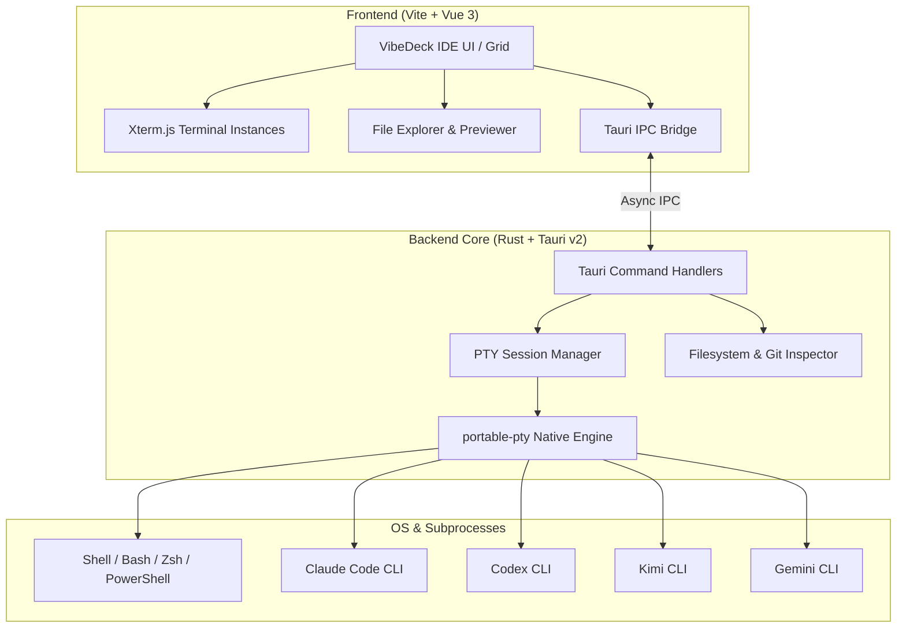

# ⚡ VibeDeck (Takara Space)

> **Next-Gen Multi-Terminal AI Agent Cockpit & IDE Workspace for Vibe Coders.**  
> Orchestrate multiple AI agents (Claude Code, OpenAI Codex, Kimi, Google Gemini, Antigravity) side-by-side with low-latency terminal grids, file management, and instant git context.

---

[](https://github.com/muhBilal/vibedeck/actions/workflows/ci.yml)
[](https://github.com/muhBilal/vibedeck/actions/workflows/release.yml)
[](https://github.com/muhBilal/vibedeck/releases)
[](https://opensource.org/licenses/ISC)
[](https://github.com/muhBilal/vibedeck/releases)
[](https://tauri.app/)
[](https://vuejs.org/)
[](https://www.rust-lang.org/)

---

## 🌟 Overview

**VibeDeck** transforms your local AI coding workflow into a high-performance, IDE-grade command center. Instead of juggling dozens of terminal windows, background processes, or browser tabs, VibeDeck provides a unified workspace engineered for parallel agent orchestration.

Run **Claude Code**, **OpenAI Codex**, **Kimi CLI**, and **Google Gemini** simultaneously—each with dedicated pseudo-terminals (PTY), hot-reloading workspaces, active Git branch recognition, and an integrated file explorer.

```
+-------------------------------------------------------------------------------+
|  [VibeDeck Cockpit]  [Tab: Project Alpha] [Tab: Research] [+]    ⚙️  Branch: main |
+-------------+-----------------------------------+-----------------------------+
| FILE TREE   | TERMINAL 1: Claude Code (Opus)   | TERMINAL 2: OpenAI Codex    |
| > src/      | > Analyzing repository structure.. | > Generating unit tests...   |
|   App.vue   |                                   |                             |
|   bridge.js +-----------------------------------+-----------------------------+
| > src-tauri | TERMINAL 3: Kimi CLI / Shell     | TERMINAL 4: Google Gemini   |
|   Cargo.toml| $ cargo check --release           | > Reviewing security policy |
|   main.rs   | [OK] Build successful (1.2s)      |                             |
+-------------+-----------------------------------+-----------------------------+
| [Status] 4 Active Agents | Memory: 42MB (Rust Engine) | Workspace: ~/Code/takara |
+-------------------------------------------------------------------------------+
```

---

## ✨ Features

### 🚀 Multi-Agent Terminal Grid
- **Native PTY Performance**: Powered by Rust (`portable-pty`) and `@xterm/xterm` with `@xterm/addon-fit` for ultra-responsive rendering with zero input lag.
- **Pre-Configured Agent Profiles**:
  - 🤖 **Claude Code** (`claude`)
  - 🧠 **OpenAI Codex** (`codex`)
  - ⚡ **Kimi CLI** (`kimi`)
  - 🔮 **Google Gemini** (`gemini`)
  - 💻 **Standard Interactive Shell** (`zsh`, `bash`, `powershell`)
- **Automated Version Detection**: Automatically probes CLI tool versions and environment paths upon launch.

### 🗂️ IDE-Grade Workspace & File Explorer
- **Integrated File Tree**: Real-time directory navigation with file type badges, sizes, and timestamps.
- **Instant Code Previews**: View file contents without leaving your terminal workspace.
- **Native Reveal Action**: 1-click open in **macOS Finder**, **Windows Explorer**, or **Linux File Manager**.
- **Per-Panel Working Directories**: Set distinct working directories (`cwd`) for individual terminals or sync them across tabs.

### 🎯 Multi-Session Tabs & Grid Customization
- **Tabbed Sessions**: Organize different tasks, projects, or agent swarms across multiple tabs.
- **Flexible Split Layouts**: 1-column, 2-column, 3-column, or 2x2 grid configurations.
- **Drag-and-Drop Reordering**: Easily reposition panels to suit your focus.
- **Custom Agent Commands**: Add and persist custom agent commands and environment arguments.

### 🌿 Git & Environment Integration
- **Live Branch Tracking**: Automatically displays current Git branch per active terminal directory.
- **Cross-Platform Path Resolution**: Seamlessly normalizes home directories, PATH variables (including Homebrew, Cargo, Local bin), and shell executables across macOS, Linux, and Windows.

---

## 📦 Downloads & Installation

Pre-built binaries are automatically generated for each release via GitHub Actions.

👉 **[Download the Latest Release](https://github.com/muhBilal/vibedeck/releases/latest)**

| Platform | Format | Architecture | Download Link |
| :--- | :--- | :--- | :--- |
| **macOS** | `.dmg` | Apple Silicon (M1/M2/M3/M4) | [Download Apple Silicon DMG](https://github.com/muhBilal/vibedeck/releases/latest) |
| **macOS** | `.dmg` | Intel (x86_64) | [Download Intel DMG](https://github.com/muhBilal/vibedeck/releases/latest) |
| **Windows** | `.exe` / `.msi` | 64-bit (x64) | [Download Windows Installer](https://github.com/muhBilal/vibedeck/releases/latest) |
| **Linux** | `.AppImage` | 64-bit (x64) | [Download AppImage](https://github.com/muhBilal/vibedeck/releases/latest) |
| **Linux** | `.deb` | 64-bit (x64) | [Download Debian / Ubuntu DEB](https://github.com/muhBilal/vibedeck/releases/latest) |

---

## 🛠️ Tech Stack & Architecture



- **Frontend**: Vue 3, Vite, `@xterm/xterm`, `@xterm/addon-fit`, CSS Variables / Modern Glass UI.
- **Backend / Core**: Tauri 2, Rust (2021 Edition), `portable-pty` for cross-platform pseudo-terminals, `serde`.
- **Packaging**: GitHub Actions CI/CD matrix compiling natively for Windows, macOS, and Linux.

---

## 💻 Local Development Guide

### Prerequisites
- **Node.js**: v18 or later (`node -v`)
- **Rust**: Stable toolchain (`rustc --version`, `cargo --version`)
- **Platform Prerequisites**:
  - **macOS**: Xcode Command Line Tools (`xcode-select --install`)
  - **Linux (Ubuntu/Debian)**:
    ```bash
    sudo apt-get update && sudo apt-get install -y \
      libwebkit2gtk-4.1-dev \
      build-essential \
      curl \
      wget \
      file \
      libxdo-dev \
      libssl-dev \
      libayatana-appindicator3-dev \
      librsvg2-dev
    ```
  - **Windows**: Microsoft Visual Studio C++ Build Tools & WebView2.

### Step-by-Step Setup

1. **Clone the repository**:
   ```bash
   git clone https://github.com/muhBilal/vibedeck.git
   cd vibedeck
   ```

2. **Install frontend dependencies**:
   ```bash
   npm install
   ```

3. **Run in development mode (with Hot Module Replacement)**:
   ```bash
   npx tauri dev
   ```

4. **Build production binaries locally**:
   ```bash
   npx tauri build
   ```
   Built artifacts will be placed in `src-tauri/target/release/bundle/`.

---

## 🔄 CI/CD & Automated Releases

VibeDeck features automated GitHub Actions workflows:

1. **Continuous Integration (`.github/workflows/ci.yml`)**:
   - Runs on every push or pull request to `main` / `master`.
   - Validates frontend builds (`npm run build`) and Rust compilation (`cargo check`).

2. **Multiplatform Release (`.github/workflows/release.yml`)**:
   - Triggered automatically when pushing a version tag (e.g., `git tag v0.1.0 && git push origin v0.1.0`).
   - Also triggerable manually via the **GitHub Actions** tab (`workflow_dispatch`).
   - Simultaneously builds on macOS, Linux, and Windows runners and attaches all compiled binaries (`.dmg`, `.exe`, `.deb`, `.AppImage`) directly to the GitHub Release.

---

## ⌨️ Shortcuts & Controls

| Shortcut / Action | Description |
| :--- | :--- |
| `Ctrl / Cmd + Click` on link | Open URL in default web browser |
| `Drag Panel Header` | Reorder terminal panels dynamically |
| `Reveal Button` | Show current file or directory in OS File Explorer |
| `Quick Agent Menu` | Switch or launch an agent in a single click |
| `Fit / Maximize` | Toggle focus view for an active agent panel |

---

## 🤝 Contributing

Contributions, issues, and feature requests are welcome!  
Feel free to check out [Issues](https://github.com/muhBilal/vibedeck/issues).

1. Fork the Project
2. Create your Feature Branch (`git checkout -b feature/AmazingFeature`)
3. Commit your Changes (`git commit -m 'Add some AmazingFeature'`)
4. Push to the Branch (`git push origin feature/AmazingFeature`)
5. Open a Pull Request

---

## 📄 License

Distributed under the ISC License. See `package.json` for details.

Developed with ❤️ for vibe coders and AI agent builders.
